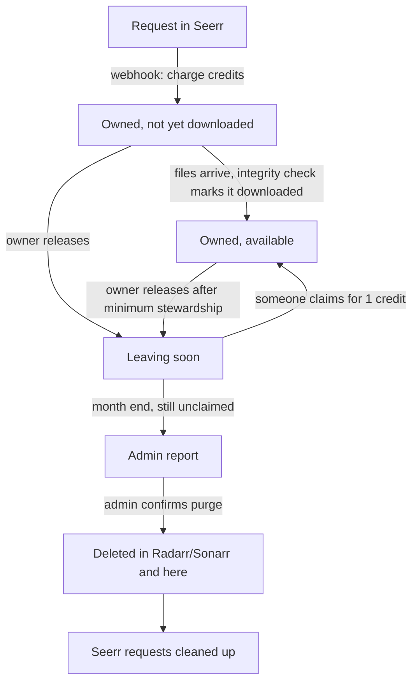

# Stewarrd

[](https://github.com/FaultyPhaser/stewarrd/actions/workflows/ci.yml)
[](LICENSE)

> [!WARNING]
> **Alpha software.** The full workflow (requests, release, claim, integrity check and purge, including media deletion) has been used and checked by hand on the author's own Seerr/Radarr/Sonarr server. It has not been formally tested or tried on other setups yet. The database schema may change between releases.
> **Back up `<DATA_DIR>/stewarrd.db` before installing or upgrading**, and run the integrity check's **dry run** before a real run. Bug reports are very welcome.

> [!CAUTION]
> **Stewarrd changes your Seerr requests.** Even with default settings, the webhook **approves or declines** every pending request depending on the user's credits. With `SEERR_SYNC=1` it also **deletes** Seerr requests (filled requests on every integrity check, and a title's requests when it is purged) and **creates** requests on users' behalf. Deleted requests can't be restored from Seerr. Back up Seerr's database before enabling it, and consider limiting it to a test user with `SEERR_SYNC_USER_IDS` first. See [What Stewarrd changes in Seerr](#what-stewarrd-changes-in-seerr).

A sidecar service that replaces Seerr request quotas with a credit economy.

- Requests cost credits and make the requester the **owner** of the media.
- Releasing media refunds a credit and moves it to **Leaving soon**.
- Anyone can **claim** (adopt) a released item for a credit.
- Unclaimed items appear in an admin report. **Media files are never deleted automatically.** Only an admin clicking Purge calls Radarr or Sonarr.

TV shows are tracked **per season**: each season is its own item with its own owner, cost and release.

The app has its own web interface and Plex login. It does not need to be injected into Seerr, and nothing in this README requires that.

## How it works

| Action | Effect |
| --- | --- |
| Request created in Seerr | Webhook charges `CREDIT_COST_MOVIE` or `CREDIT_COST_TV_SEASON` per season and approves it. If the user can't afford it, the request is declined. |
| Release ("done watching") | Allowed once the owner has held the item for the minimum stewardship time (`MIN_STEWARDSHIP_DAYS`, default 30, editable by the admin in the dashboard; the admin is exempt). The owner gets +1 credit. |
| Claim / adopt | The claimer pays 1 credit and becomes the owner. The releaser keeps the +1 they earned and can claim it back too. |
| Admin buyout | Free. Refunds +1 to the owner if the item was still active. |
| Admin | Infinite credits. Direct Radarr/Sonarr additions are owned by the admin. |
| Month end | A report is written to `/app/data` and shown in the admin dashboard. The admin confirms each purge. |
| Weekly (Sunday 03:00) | Integrity check (also on demand, with a dry run). It recomputes balances from the ledger against `DEFAULT_CREDITS`, then reconciles with Radarr/Sonarr (what exists there must exist here, and units whose item is gone are removed), then with open Seerr requests (added for the original requester and charged). Finally it deletes filled Seerr requests (needs `SEERR_SYNC=1`). Every change is logged. |

Only the first import reads Seerr for ownership. After that Radarr/Sonarr decide what exists, and Seerr is only read for open requests that still need filling. Removals are blocked if a service returns nothing or if more than 25% of a type would be removed (override with `{"force": true}`).

## Lifecycle of a request and an item

An **item** (unit) is one movie or one TV season. Each has an owner, a status, and an `available` flag (files downloaded or not). Its identity is its own `ref_key` (`movie:<TMDB id>`, or `tv:<TVDB id>` for a show, falling back to the TMDB id) plus the season number. The `seerr_id`, `tmdb_id` and `tvdb_id` columns are all optional links, so an item exists even if Seerr has never heard of it. Seerr requests and items are related but not 1:1. Stewarrd's database is the source of truth for **ownership**, and Radarr/Sonarr are the source of truth for **what exists**.



### 1. Request

1. A user requests a title in Seerr. The webhook (`MEDIA_PENDING`) charges `CREDIT_COST_MOVIE` or `CREDIT_COST_TV_SEASON` per season, then approves the request. If the user can't afford it, the request is declined.
2. The user becomes the **owner** of the item or items. The request stays in Seerr until it is filled. Auto-approved requests (the admin, or users with Auto-Approve) arrive as `MEDIA_AUTO_APPROVED`. They are charged and tracked the same way, without a second approve call. If one can't be afforded, Stewarrd tries to decline it, and only logs the failure if Seerr refuses.
3. Until the files arrive the item is **not downloaded**. It is still owned and counted.
4. When Radarr/Sonarr finish and Seerr reports the files, the integrity check marks the item downloaded.

### 2. Owned

- Owners keep the item as long as they like. Releasing is the only way to give it up.
- Admin-owned items cost nothing. Titles added directly in Radarr/Sonarr are owned by the admin.

### 3. Release (done watching)

- The owner clicks release. It is allowed once the owner has held the item for the minimum stewardship time. It counts from the request, or from the claim if the admin setting "Apply to claimed items" is on. Items that existed before this feature, and items assigned by the admin, have no hold. The admin is never held. Deleting an item (admin purge, or removed by the integrity check) always refunds the owner what they paid, whatever the minimum says.
- This works the same for downloaded and not-yet-downloaded items. The owner gets +1 credit and the item moves to **Leaving soon**.
- Releasing **never touches Seerr**.

### 4. Leaving soon and claim

- Leaving soon items stay in the library. Anyone can **claim** one for 1 credit and become the owner. The previous owner keeps the +1 they earned and may claim it back too.
- On a claim, if Seerr has no request for that title and `SEERR_SYNC=1`, Stewarrd creates one for the new owner. If one already exists, nothing changes.
- An admin can assign or buy out an item for free. A buyout refunds +1 to the owner if the item was still active.

### 5. Month end and purge

- On the 1st at 00:05 a snapshot of the Leaving soon list is written to `/app/data`. On the last days of the month at 23:55 a report of items still unclaimed is built. Neither step deletes anything.
- The admin reviews the report and confirms each purge. Purge deletes the files through Radarr or Sonarr, then removes the item from Stewarrd. A `PURGED` ledger entry is kept for the history, and the item no longer exists as a row, so it can be requested again later.
- Admin-run purges use `GET /api/admin/purge/:unitId/preview` as a dry run of the Seerr side.

### 6. What happens to Seerr requests on purge

With `SEERR_SYNC=1`, a purge looks at every open (not declined or failed) non-4K Seerr request for that title:

| Request state | Action |
| --- | --- |
| Movie, a whole-show purge, or every season on the request is filled | Delete the request. |
| Request also lists seasons that are still unfilled | Delete the request, then create a new one for the same requester with only the unfilled seasons. |
| Declined, failed or 4K | Leave alone. |

Seerr can't shrink an approved request, so delete and recreate is the only way to remove one season. Available seasons stay available in Seerr. Once Seerr's own availability sync marks a removed season as deleted, it can be requested again. If the recreate fails, the failure is logged in the integrity log, and the integrity check recovers the unfilled item from the open Seerr request.

### 7. Integrity check

Run weekly (Sunday 03:00) or on demand from Admin mode. **Dry run** shows the planned changes and writes nothing to the database or other services. It does write a plain-text report with every item, owner and reason to `<DATA_DIR>/integrity-reports/`, and the result message has a **Download full details** link (`GET /api/admin/integrity/report/:name`). The newest 20 reports are kept. It runs these steps in order:

1. **Balances and orphans.** Each non-admin balance is recomputed from the ledger and allowance, and mismatches are corrected. Orphaned units and ledger rows are reported.
2. **Reconcile with Radarr/Sonarr.** Radarr and Sonarr alone decide what exists, matched by the ids they use: TMDB id for movies, TVDB id for shows. Seerr is not needed for this, so items Seerr has never seen are still added, owned by the admin at no cost. Units whose item has left Radarr/Sonarr are removed, with no refund. A season exists if it is monitored or has files. A show unit that is missing its TVDB or TMDB id gets it filled in from the Sonarr series it matches (by id, then title), and the change is logged as `IDS_BACKFILLED`. Entries with no TMDB/TVDB id can't be tracked. They are listed in the report and logged as `NO_USABLE_ID`.
3. **Reconcile with open Seerr requests.** An approved request that Seerr still has to fill, and that Stewarrd doesn't track, is added for the original requester and charged. These units are never removed just because Radarr/Sonarr don't have them yet. A season only counts while Seerr reports it as pending or processing, so a removed season is not brought back by a stale request. One show can be split across several Seerr records, and that is fine: Stewarrd groups it by the Sonarr TVDB id.
4. **Seerr cleanup.** Completed non-4K Seerr requests are deleted, so Seerr only tracks items that still need filling. This only runs if every service was read successfully, and it needs `SEERR_SYNC=1`.

Safeguards:

- If any of Seerr, Radarr or Sonarr can't be read, the reconcile is skipped entirely.
- Removals are blocked when a service returns nothing, or when more than 25% of a type (minimum 5) would be removed. `{"force": true}` lifts the percentage cap.
- Every change is written to the integrity log (`UNIT_ADDED`, `UNIT_REMOVED`, `AVAILABILITY_UPDATED`, `IDS_BACKFILLED`, `NO_USABLE_ID`, `RECONCILE_SKIPPED`).
- The integrity check does nothing until the first import has run.

### 8. Reset

**Reset & re-import** is the only other data tool. It erases local data and rebuilds it from Seerr. Because filled requests are deleted from Seerr over time, Seerr no longer holds the full ownership history, so **back up `stewarrd.db` first**. Allowance overrides are lost in a reset.

## What Stewarrd changes in Seerr

Stewarrd uses your Seerr API key to write to Seerr, not only to read from it. Media files are only ever deleted through Radarr/Sonarr when an admin confirms a purge.

| When | Change in Seerr | Setting |
| --- | --- | --- |
| A request is created (webhook) | **Approves** it if the user can afford it, otherwise **declines** it. Auto-approved requests that can't be afforded are declined after the fact. | Always on |
| Integrity check (weekly, or run manually) | **Deletes** completed (filled) non-4K requests, for every user. | `SEERR_SYNC=1` |
| Admin purge | **Deletes** the title's open non-4K requests. Requests that still list unfilled seasons are **deleted and recreated** with only those seasons. | `SEERR_SYNC=1` |
| A user claims an item that has no Seerr request | **Creates** a request in the new owner's name. | `SEERR_SYNC=1` |
| Release ("done watching") | Nothing. | n/a |

- `SEERR_SYNC` is **off by default** (it is forced on in `ADMIN_RUN` testing mode). `SEERR_SYNC_USER_IDS` limits it to the listed Seerr user ids.
- Requests deleted by Stewarrd disappear from Seerr's request history and from users' request lists. Ownership is kept in Stewarrd's database, but Seerr can't restore them. **Back up Seerr's database (its `config/db` folder) before turning `SEERR_SYNC` on.**
- Because filled requests are deleted, **Reset & re-import** can't rebuild ownership from Seerr afterwards. Back up `stewarrd.db` too.
- Don't run Stewarrd alongside other tools that also clean up Seerr requests.

## Requirements

- Seerr (with an API key), Docker, and a Plex account for every user.
- Optional: Kometa (Plex "Leaving soon" collection).
- Radarr and Sonarr are needed for admin purge and for the integrity check's reconcile step. Without one of them, its units are treated as existing and never removed.

## Configuration

Copy `.env.example` to `.env` and fill it in. Required: `SEERR_URL`, `SEERR_API_KEY`, `ADMIN_USER_ID` and `WEBHOOK_SECRET`. Every variable is documented in `.env.example`.

- URLs must be reachable **from the container**. If the containers don't share a Docker network (for example on Unraid's default bridge), container names don't resolve, so use `http://<HOST>:<port>`.
- `.env` holds API keys: `chmod 600 .env`. Keys stay server-side and are never sent to browsers.
- Changing `DEFAULT_CREDITS` shifts every user's balance at the next integrity check, because balances are checked against that setting.
- `DEFAULT_CREDITS` is the default total for everyone. In Admin mode you can set a **per-user allowance override** (or clear it to return to the default). The user's balance changes immediately by the difference, the change is written to the integrity log, and the integrity check uses the override instead of `DEFAULT_CREDITS` for that user. API: `POST /admin/allowance` with `{ "userId": 5, "allowance": 8 }` (`null` clears).

## Login

Users sign in with their Plex account through Plex's PIN flow. No app registration is needed, and the app never sees a Plex password.

- A Plex account can sign in only if it belongs to a Seerr user. A Plex login never creates a user.
- Local Seerr accounts without a Plex id can't sign in.
- Sessions are signed, HTTP-only cookies lasting `SESSION_DAYS`. Set `SESSION_SECRET`, or one is generated and kept in `/app/data`.
- Cookies are marked `Secure` only when the request arrived over HTTPS. Behind an HTTPS reverse proxy, set `TRUST_PROXY=1`.
- Plex sends the browser back to the address you opened the app at, so that address must be reachable from your browser.

## Deployment

Any Docker host works. Placeholders used below:

| Placeholder | Meaning |
| --- | --- |
| `<REPO-URL>` | Git URL of this repository |
| `<HOST>` | Address of the Docker host, as reachable from your browser and from Seerr |
| `<SRC_DIR>` | Where the code is checked out, e.g. `/opt/stewarrd` |
| `<CONFIG_DIR>` | Where the env file lives, outside the repository, e.g. `/opt/stewarrd-config` |
| `<DATA_DIR>` | Persistent data directory, e.g. `/opt/stewarrd-data` |

On Unraid, use paths under `/mnt/user/appdata/`.

### 1. Get the code

```bash
git clone <REPO-URL> <SRC_DIR>
cd <SRC_DIR>
```

### 2. Configure

```bash
mkdir -p <CONFIG_DIR> <DATA_DIR>
cp .env.example <CONFIG_DIR>/stewarrd.env
chmod 600 <CONFIG_DIR>/stewarrd.env
```

Edit the env file. Use `http://<HOST>:<port>` for every `*_URL` if the containers don't share a Docker network, and make sure none of `DEV_MODE`, `ADMIN_RUN` or `ADMIN_RUN_ALLOW_REMOTE` are set. The container runs as `1000:1000`, so give it the data directory:

```bash
chown -R 1000:1000 <DATA_DIR>
```

### 3. Get the image and run

Prebuilt images (amd64 and arm64) are published to GitHub Container Registry:

```bash
docker pull ghcr.io/faultyphaser/stewarrd:alpha
```

Tags: `alpha` (latest alpha release), an exact version such as `0.1.0-alpha.1`, and `edge` (latest `main`, untested). Pin an exact version if you want upgrades only when you choose. The examples below use `stewarrd:latest`; replace it with the GHCR image, or build it yourself:

```bash
docker build -t stewarrd:latest .
```

**Docker Compose:** `docker-compose.yml` is included. Point it at your env file and data directory, then run `docker compose up -d --build`. It publishes the port on `127.0.0.1` only, so change that if your reverse proxy or browser is on another machine.

**Plain Docker:**

```bash
docker run -d --name stewarrd --restart unless-stopped \
  --user 1000:1000 --cap-drop=ALL --security-opt no-new-privileges:true --read-only \
  --env-file <CONFIG_DIR>/stewarrd.env \
  -p 3055:3000 -v <DATA_DIR>:/app/data \
  stewarrd:latest
```

**Unraid:** there is no `docker compose` by default, so build the image over SSH as above and use **Docker → Add Container → Advanced View**:

| Field | Value |
| --- | --- |
| Name | `stewarrd` |
| Repository | `stewarrd:latest` |
| Port | Container `3000` → Host `3055` |
| Path | Container `/app/data` → `<DATA_DIR>` (read/write) |
| Extra Parameters | `--env-file <CONFIG_DIR>/stewarrd.env --user 1000:1000 --cap-drop=ALL --security-opt no-new-privileges:true --read-only` |

Do **not** map any media paths. If the container won't start, remove `--read-only` first. The port is exposed on your LAN, so don't forward it on your router.

### 4. First sign-in and existing data

Open `http://<HOST>:3055/` and use **Sign in with Plex** as the admin user (`ADMIN_USER_ID`). On the first admin sign-in to an empty database, the app imports users, requests and ownership from Seerr automatically. Seerr is only read, and each user is charged for the content they already hold.

Afterwards, the **Admin mode** button shows the admin tools:

- **Assign media** to a user, with or without charging credits.
- **Integrity check**, with a **dry run** button that shows what it would change without changing anything.
- **Reset & re-import** (full data reset), which erases local data after a confirmation.
- Review or purge unclaimed items.

You can also start from a database you already imported elsewhere. Stop the app that wrote it, so no `-wal` file is mid-write, and copy `stewarrd.db*` into `<DATA_DIR>` before starting the container.

### 5. Check it

```bash
curl http://<HOST>:3055/healthz
curl http://<HOST>:3055/api/kometa/leaving-soon-movies.txt
```

The container log should show `listening on 0.0.0.0:3000`.

### 6. Seerr webhook

In Seerr → Settings → Notifications → Webhook:

- **URL:** `http://<HOST>:3055/api/seerr-webhook`
- **Authorization Header:** `Bearer <WEBHOOK_SECRET>`
- **Notification types:** Request Pending Approval **and** Request Automatically Approved. The service acts on `MEDIA_PENDING` and `MEDIA_AUTO_APPROVED`, and logs any other type it ignores.
- **JSON payload:** leave the default
- Turn off auto-approval for regular users in Seerr, so this service decides.

### Updating

Back up `<DATA_DIR>/stewarrd.db*` first and read [CHANGELOG.md](CHANGELOG.md). Updates can run database migrations.

With the prebuilt image, `docker pull` the new tag. When building from source:

```bash
cd <SRC_DIR>
git pull
docker build -t stewarrd:latest .
```

Then recreate the container (`docker compose up -d --build`, or **Force update** on Unraid). The database in `/app/data` is kept.

## Kometa

The app serves plain text lists that Kometa reads with its `text_file` builder. They are generated from the database on every request, so they are current whenever Kometa reads them.

| URL | Content |
| --- | --- |
| `/api/kometa/leaving-soon-movies.txt` | One TMDb id per line (movie libraries) |
| `/api/kometa/leaving-soon-shows.txt` | One TVDb id per line (show libraries). A show is listed if any season is released. |
| `/api/kometa/leaving-soon.json` | Combined view, not read by Kometa |

`deploy/leaving_soon.yml` is a starting collection file. Replace the host with one Kometa can reach, for example `http://<HOST>:3055`. These endpoints are unauthenticated and return ids only, so keep them on your LAN.

Kometa only updates Plex when it runs, so a release shows up in Plex after Kometa's next run.

## Endpoints

- **User:** `GET /api/user/credits`, `GET /api/user/media`, `GET /api/media/flagged`, `GET /api/media/status?type=&id=`, `POST /api/media/flag`, `POST /api/media/save`, `POST /api/media/flag-show`, `POST /api/media/save-show`.
- **Admin:** `GET /api/admin/report`, `POST /api/admin/purge/:unitId`, `GET /api/admin/purge/:unitId/preview`, `POST /api/admin/purge-show/:groupKey`, `POST /api/admin/integrity/run`, `GET /api/admin/integrity/log`, `GET /api/admin/setup-status`, `GET /api/admin/users`, `GET /api/admin/media`, `POST /api/admin/assign`, `POST /api/admin/assign-bulk`, `POST /api/admin/import`.
- **Other:** `POST /api/seerr-webhook`, `GET /api/kometa/*`, `GET /healthz`, `POST /api/auth/plex/start`, `/plex/poll`, `/logout`.

## Testing modes

Never use these in production. They refuse to start when `NODE_ENV=production`, which the Docker image sets, so you must override it.

- **`DEV_MODE=1`:** fake users and simulation endpoints. Seerr, Radarr and Sonarr are disabled.
  ```bash
  DEV_MODE=1 MIN_STEWARDSHIP_DAYS=30 DATA_DIR=./data-dev npm start
  ```
- **`ADMIN_RUN=1`:** a user picker for "acting as", with real Seerr (reads, and request create/delete). Radarr and Sonarr stay disabled. It listens on `127.0.0.1` unless `ADMIN_RUN_ALLOW_REMOTE=1` is set.

Both include a **Reset & import real data** button, which erases the local database first.

## Security notes

- Do not expose port 3000 or `/api/seerr-webhook` publicly.
- The container runs as 1000:1000 with a read-only root filesystem and only `/app/data` mounted. There are no media mounts.
- API keys stay in server-side environment variables.
- Serve the app over HTTPS if it is reachable outside your LAN.

Report vulnerabilities privately as described in [SECURITY.md](SECURITY.md).

## Tests

```bash
npm test            # backend
npm run test:web    # frontend
npm run typecheck
```

## Limitations

- Seerr can't edit approved requests, so releasing or claiming one season of a multi-season request doesn't change Seerr's request. The Seerr request list can differ from per-season ownership, which is tracked here.
- Sonarr removes whole series. Purging one season deletes that season's episode files and unmonitors it, and the series is removed only when every season is released. This hasn't been run against a real Sonarr.
- The interface is functional but minimally styled.

## Frontend development

Both browser UIs (the dashboard and the UI injected into Seerr) are Preact + TypeScript in `web/`:

- `web/dashboard/`: the dashboard. Built to `public/dashboard.js` and `public/dashboard.css`.
- `web/inject/`: the UI injected into Seerr. Built to `public/inject.js` and `public/inject.css`. Its CSS classes are all prefixed `sc-`.
- `web/shared/`: API client, types, formatting and the colour tokens (`tokens.css`) used by both.

The files in `public/` are generated (git-ignored). The Docker build runs `npm run build:web`, so the proxy URLs and nginx config are unchanged.

```sh
npm install
npm run build:web   # build both bundles into public/
npm run test:web    # Vitest for the frontend logic
npm run typecheck
npm run dev:web     # Vite dev server with hot reload
```

`npm run dev:web` starts Vite with hot reload. Run the sidecar in `DEV_MODE` first; Vite proxies `/sidecar-api` and `/sidecar-assets` to it (`SIDECAR_URL`, default `http://127.0.0.1:3000`).

**Dashboard.** Open `http://localhost:5173/`. It uses fake login (flags from `DEV_MODE` and `ADMIN_RUN`). The Plex sign-in flow is not available here; use the sidecar's own `/` for that.

**Injected UI inside real Seerr pages.**

1. Start Vite with your Seerr address (no path, check the spelling):
   ```sh
   SEERR_DEV_URL=http://your-seerr:5055 npm run dev:web
   ```
   Vite then proxies Seerr and adds the hot-reloading script, as nginx does in production.
2. Open `http://localhost:5173/` (not your usual Seerr address) and log in to Seerr there. Cookies are per address, so the normal login does not carry over.
3. **Pick a dev user.** In `DEV_MODE` the sidecar ignores the Seerr session and only accepts the `dev_user` cookie, so nothing renders until one is set. Open `http://localhost:5173/web/dashboard/index.html`, pick a user in the dev panel, then go back to `http://localhost:5173/` and reload. The user must exist in the sidecar's database (the dev seed creates some).

The side bar, panel and drawer stay hidden until `GET /sidecar-api/user/credits` succeeds. If they do not appear, check that call in the browser's Network tab: `401` means no dev user or Seerr session was accepted, `502` means `SIDECAR_URL` is wrong or the sidecar is down. To test with the real Seerr login instead, run the sidecar without `DEV_MODE`.

With `SEERR_DEV_URL` set, the dashboard moves to `/web/dashboard/index.html`.

## Live info inside Seerr (optional)

`public/inject.js` (built from `web/inject`) adds to Seerr's own pages, through your reverse proxy:

- Your credit balance on the Stewarrd side bar.
- Per-title cost ("Requesting costs 2 credits per season. You have 5") and a warning when the last request was declined, with the reason.
- Done watching / Save buttons on titles you own or can adopt.
- If the user can't afford a request, Seerr's **Request** button stays clickable but shows a message instead of submitting. The webhook still declines on the server, so this is a convenience, not the enforcement.

The script calls `/sidecar-api/*` on the Seerr origin. The browser sends the user's Seerr session cookie (`connect.sid`), and the app asks Seerr who that is. That session is accepted for the user endpoints only, never for `/api/admin`. The Seerr cookie must be sent, so the proxy must serve Seerr and `/sidecar-api/` on the same domain.

Every webhook outcome (approved, declined, refunded) is stored and served by `GET /api/user/activity`.

### Nginx Proxy Manager

Edit the Seerr proxy host, then **Advanced → Custom Nginx Configuration**. Replace `<HOST>:3055` with the address your NPM container can reach (the Unraid IP and the host port you mapped):

```nginx
location /sidecar-api/ {
    proxy_pass http://<HOST>:3055/api/;
    proxy_set_header Host $host;
    proxy_set_header X-Forwarded-For $proxy_add_x_forwarded_for;
    proxy_set_header X-Forwarded-Proto $scheme;
}

location /sidecar-assets/ {
    proxy_pass http://<HOST>:3055/public/;
}
```

The script must also be injected into Seerr's HTML. NPM's proxy host already defines `location /`, so a second `location /` in the Advanced box is rejected. Add this in the same Advanced box at server level instead (needs `Accept-Encoding` cleared so the body isn't compressed):

```nginx
proxy_set_header Accept-Encoding "";
sub_filter '</head>' '<script src="/sidecar-assets/inject.js" defer></script></head>';
sub_filter_once on;
```

Do not expose `/api/seerr-webhook` or `/api/admin` through the proxy. `/sidecar-api/` maps to `/api/`, so those paths would be reachable as `/sidecar-api/admin/...`: the admin routes still require the Plex login, and the webhook still requires its secret. If you'd rather not expose them at all, add `location ~ ^/sidecar-api/(admin|seerr-webhook) { return 404; }` above the block.

## Contributing

Bug reports and pull requests are welcome. Please run the tests above before opening a PR. Development notes, known limitations and the roadmap are in [docs/development-notes.md](docs/development-notes.md).

## License

Stewarrd is licensed under the [GNU General Public License v3.0](LICENSE) or later, like Sonarr, Radarr and the rest of the *arr stack.
